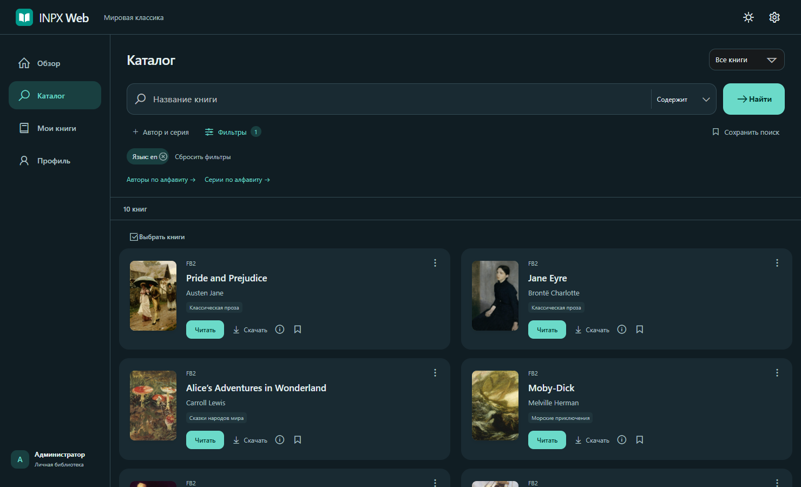
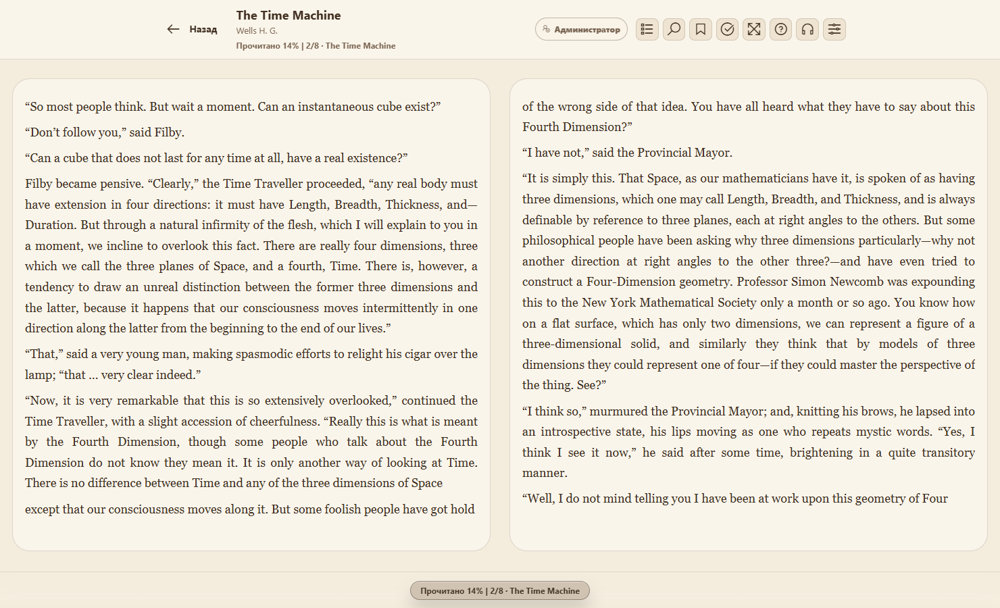

<p align="center">
  <a href="https://t.me/inpxweb">
    
  </a>
</p>

# inpx-web-7z

Веб-каталог и читалка для домашней библиотеки в формате INPX с архивами ZIP и 7z. Есть поиск по каталогу, личные полки, закладки, OPDS, синхронизация с KOReader и отправка книг через Telegram или почту.

[](https://github.com/AceAsket/inpx-reader-releases/releases/latest)
[](#сервер-на-android)

## Выпуски

Чтобы ускорить работу с большими библиотеками, мы перенесли разработку сервера с Node.js на Rust. **Node.js 1.8.3** — последняя ветка классического сервера. Она будет получать только исправления ошибок. Все новые функции будут выходить только в **Rust 2.x**.

| Редакция | Docker-образ | ZIP и установщик Windows |
| --- | --- | --- |
| Rust 2.0.3 · стабильная | `aceasket/inpx-web-7z:2.0.3` или `:latest` | [Скачать Rust 2.0.3](https://github.com/AceAsket/inpx-web/releases/tag/v2.0.3) |
| Классический Node.js 1.8.3 · стабильная | `aceasket/inpx-web-7z:1.8.3` | [Скачать Node.js 1.8.3](https://github.com/AceAsket/inpx-web/releases/tag/v1.8.3) |

Разработка Rust 2.x ведётся в ветке `develop`. Ветка `main` также содержит сервер Rust. При обновлении контейнера с тегом `latest` он перейдёт на Rust. Чтобы продолжить использовать стабильный Node.js, закрепите тег `1.8.3`. Классический сервер с JembaDB поддерживается в ветке [nodejs_depr](https://github.com/AceAsket/inpx-web/tree/nodejs_depr).

Перед переходом с Node.js остановите прежний сервер и сохраните копию каталога данных, включая `db` и внешний файл фильтра, если он используется. При первом запуске Rust сохраняет снимок пользовательских данных и строит новый индекс с сохранением идентификаторов книг, полок, закладок и прогресса. [Переход и откат](./docs/upgrade-rollback.md)

## Запуск Rust в Docker

Замените путь к папке библиотеки и имя файла `.inpx` на свои.

```sh
docker run -d --name inpx-web --restart unless-stopped \
  -p 12380:12380 \
  -e INPX=/library/my-library.inpx \
  -e LIBDIR=/library \
  -v inpx-web-data:/usr/local/bin/.inpx-web \
  -v /path/to/library:/library:ro \
  aceasket/inpx-web-7z:2.0.3
```

Откройте `http://localhost:12380` на сервере или укажите его адрес вместо `localhost`. Профили и настройки сохраняются в томе `inpx-web-data`. [Пример Docker Compose](./docker-compose.full.yml) · [Docker Hub](https://hub.docker.com/r/aceasket/inpx-web-7z)

### Nginx Proxy Manager и Windows standalone

В карточке Proxy Host укажите адрес Windows-сервера и порт INPX Web. Включите **Websockets Support**. На Windows добавьте в `config.json` адрес, с которого подключается Nginx Proxy Manager. Ниже пример для прокси с адресом `192.168.1.99`.

```json
{
  "trustProxy": true,
  "trustedProxyCidrs": ["192.168.1.99/32"]
}
```

Массив подходит и для 2.0.2, и для 2.0.3. В 2.0.3 также можно использовать строку из адресов и CIDR через запятую. После перезапуска откройте библиотеку через HTTPS и проверьте запрос `/ws` в **Сеть → WS**. При успешном подключении статус `101`. Если в журнале появился `foreign-origin`, поле `peer` показывает TCP-адрес, который видит INPX Web. Сверьте его со списком `trustedProxyCidrs`. [Заголовки Nginx Proxy Manager](https://github.com/NginxProxyManager/nginx-proxy-manager/blob/develop/docker/rootfs/etc/nginx/conf.d/include/proxy.conf)

### Caddy и Docker на Synology

Если Caddy работает на отдельной машине, укажите в Caddyfile адрес NAS и опубликованный порт библиотеки. В примере Caddy имеет адрес `192.168.31.49`, а Synology — `192.168.31.97`. Замените домен и адреса своими. Caddy передаёт WebSocket и заголовки внешнего адреса по умолчанию. [Документация Caddy](https://caddyserver.com/docs/caddyfile/directives/reverse_proxy#defaults)

```caddyfile
books.example.org {
	reverse_proxy 192.168.31.97:12380
}
```

Для `INPX_TRUSTED_PROXY_CIDRS` нужен **адрес источника TCP-соединения, который видит контейнер**. Чтобы его узнать, подключитесь к NAS по SSH и посмотрите IP контейнера в сети библиотеки.

```sh
sudo docker inspect -f '{{range $name, $net := .NetworkSettings.Networks}}{{println $name $net.IPAddress}}{{end}}' inpx-web
```

Подставьте этот IP вместо `172.18.0.2` в команду ниже. Пока она ждёт, откройте библиотеку через HTTPS-домен Caddy в новом окне браузера. Команда показывает первый пакет открытия TCP-соединения к библиотеке.

```sh
sudo tcpdump -nni any -c 1 'dst host 172.18.0.2 and tcp dst port 12380 and tcp[tcpflags] & tcp-syn != 0'
```

Например, строка `172.18.0.1.54000 > 172.18.0.2.12380` означает, что библиотека видит источником шлюз Docker `172.18.0.1`. Число `54000` — временный порт. Если слева виден адрес самого Caddy, используйте его. Суффикс `/32` обозначает один IPv4-адрес.

**Если источником оказался шлюз**, такой настройке будут доверены все подключения, которые Docker передаёт с адреса шлюза. Сначала разрешите доступ к опубликованному TCP-порту `12380` только с адреса Caddy (`192.168.31.49` в примере). Правило должно фильтровать входящие подключения к порту Docker до подмены адреса. Проверьте с другого устройства в LAN, что прямое подключение к `192.168.31.97:12380` закрыто, а через Caddy библиотека открывается. [Фильтрация опубликованных портов Docker](https://docs.docker.com/engine/network/firewall-iptables/#restrict-external-connections-to-containers)

Добавьте значения в `environment` сервиса `inpx-web` в Compose. Для приведённого вывода подойдут такие значения.

```yaml
environment:
  INPX_TRUST_PROXY: "true"
  INPX_TRUSTED_PROXY_CIDRS: "172.18.0.1/32"
```

Выполните `docker compose up -d --force-recreate inpx-web` из каталога проекта. Откройте библиотеку через HTTPS и проверьте запрос `/ws` в инструментах разработчика браузера (**Сеть → WS**). Статус `101 Switching Protocols` подтверждает, что WebSocket открылся.

**Если Caddy тоже в Docker на том же NAS**, подключите оба контейнера к общей пользовательской сети, уберите `ports` у `inpx-web` и укажите в Caddyfile `reverse_proxy inpx-web:12380`. Закрепите за Caddy IPv4-адрес в этой сети и укажите его с `/32`. Клиенты в LAN обращаются к библиотеке через Caddy. [Сети Docker bridge](https://docs.docker.com/engine/network/drivers/bridge/)

## IPv6 в Rust standalone

По умолчанию сервер слушает `0.0.0.0` (IPv4). Чтобы включить все IPv6-интерфейсы в Linux standalone, добавьте `--host=::` к обычной команде запуска. Для постоянной настройки задайте `"host": "::"` в секции `server` файла `config.json`. В примере сервер слушает порт `12382`, а команда `curl` проверяет доступ с этой же машины.

```sh
./inpx-web --host=:: --port=12382
# В другом терминале
ss -6lnt 'sport = :12382'
curl --noproxy '*' -g -6 'http://[::1]:12382/ready'
```

Для доступа только с этой машины укажите `--host=::1`. Если в Linux `net.ipv6.bindv6only=0`, слушатель на `::` принимает также IPv4.

`::` — адрес слушателя. `::/0` — сеть, которая включает все IPv6-адреса. `INPX_TRUSTED_PROXY_CIDRS` управляет доверием к заголовкам прокси и не меняет слушатель. Для прямого входа эта переменная не нужна, а для Caddy укажите его адрес с `/128`. У опубликованного порта Docker IPv6 может работать при IPv4-слушателе внутри контейнера. [Публикация портов Docker](https://docs.docker.com/engine/network/port-publishing/)

### Caddy по IPv6

IPv6-адреса в `INPX_TRUSTED_PROXY_CIDRS` поддерживаются в Rust 2.0.3. В примере адрес Caddy — `2001:db8:31::49`, адрес библиотеки — `2001:db8:31::97`. Подставьте свои адреса. На машине библиотеки задайте переменные перед запуском сервера.

```sh
export INPX_TRUST_PROXY=true
export INPX_TRUSTED_PROXY_CIDRS='2001:db8:31::49/128'
./inpx-web --host=:: --port=12382
```

В Caddyfile укажите адрес библиотеки в квадратных скобках.

```caddyfile
books.example.org {
	reverse_proxy [2001:db8:31::97]:12382
}
```

Чтобы проверить адрес Caddy, откройте библиотеку через прокси и выполните на машине библиотеки `ss -6nt 'sport = :12382'`. Возьмите адрес из столбца **Peer Address:Port**, уберите скобки и порт, добавьте `/128`. Если доверенных прокси несколько, перечислите их через запятую, например `2001:db8:31::49/128,192.168.31.49/32`. После перезапуска проверьте в браузере **Сеть → WS → /ws**. При успешном подключении статус — `101`.

## Настройки сервера во время работы

В Rust откройте **Настройки библиотеки → Управление библиотекой** из профиля администратора. Здесь можно изменить правила входа и SSO, гостевой доступ, доверенные IPv4/IPv6-сети и ограничение попыток входа, а также расписание проверки INPX и параметры конвертации, обложек, очередей и Silero.

- В **Общем OPDS** можно выбрать обычный режим или Tolino и указать JSON-файл общих подборок. Укажите абсолютный путь или путь относительно каталога данных. Сервер проверит файл перед сохранением.
- Для **fb2cng** можно указать YAML-конфигурацию и дополнительные аргументы, по одному аргументу на строку. Изменения используют следующие задания конвертации. Переключатель **KOReader** управляет синхронизацией для всей библиотеки.
- Для **Audiobookshelf** и **Prometheus** можно задать параметры подключения и сменить токен. Смена токена действует со следующего запроса. Токены сохраняются зашифрованными и скрыты в интерфейсе и экспорте.
- В параметрах запуска указаны адрес, префикс URL и пути к данным и конфигурации. В разделе источников видны действующая библиотека и параметры запуска, которые переопределяют её источники.

Явно заданные переменные окружения для этих полей имеют приоритет. Админка показывает имя переменной и блокирует редактирование поля. Гостевой доступ меняется и в открытых вкладках. При изменении списка прокси сервер перепроверяет действующие WebSocket. Изменение предела размера книги для ISBN применяется к следующей подготовке. Для уже поставленных в очередь задач Silero сохраняются исходные настройки.

В **Логировании** можно выбрать уровень и на 15 минут включить `debug`. Технические записи идут в консоль. Если включить запись в файл, сервер использует `logDir` или каталог `log` внутри каталога данных и хранит текущий файл и одну предыдущую копию по 8 МиБ. Для постоянного уровня при запуске задайте `--log-level=warn` или `INPX_LOG_LEVEL=warn`. Аргумент командной строки имеет приоритет.

Путь к фильтру INPX и режим экономии памяти настраиваются в **Проверке INPX и ISBN**. После сохранения нажмите **Переиндексировать**. Текущий каталог останется доступен во время подготовки нового индекса.

В разделе **Размер запросов и резервных копий** можно задать пределы WebSocket, импорта и бэкапов. Снижение действует со следующего запроса. Чтобы запросы большего размера стали доступны, переподключите вкладку к серверу.

## Интерфейс

На обзоре видны текущая книга, прогресс чтения и полки с новинками.

[](./docs/images/rust-2-overview.png)

| Каталог с фильтрами и карточками книг | Читалка в режиме разворота, тема «Сепия» |
| --- | --- |
| [](./docs/images/rust-2-catalog.png) | [](./docs/images/rust-2-reader.png) |

Скриншоты сделаны в Rust 2.0.0 на демонстрационной библиотеке. Тексты и иллюстрации взяты из [Standard Ebooks](https://standardebooks.org/ebooks).

## Android

### Читалка INPX Reader для Android

Подключается к библиотеке по адресу сервера или QR-коду. Книги и готовую озвучку можно скачать для чтения и прослушивания без сети. [Скачать INPX Reader](https://github.com/AceAsket/inpx-reader-releases/releases/latest)

### Сервер на Android

INPX Server запускает библиотеку с локальной папки или по SMB на телефоне, планшете или ТВ-приставке с Android 9+. Выбирайте APK по разрядности Android. [Предрелиз и контрольные суммы](https://github.com/AceAsket/inpx-web/releases/tag/android-v0.7.3) · [Инструкция](https://github.com/AceAsket/inpx-web/blob/android/android/README.md)

## Документация

- [Справочник по установке и настройке](./REFERENCE.md) · [Сборка Rust из исходников](./REFERENCE.md#сборка-с-автономным-rust-сервером)
- [Обновление и откат](./docs/upgrade-rollback.md) · [Профили ресурсов](./docs/resource-profiles.md)
- [OPDS 2.0](./docs/opds-v2.md) · [Синхронизация с KOReader](./docs/koreader-sync.md) · [Озвучка Silero](./docs/silero-tts.md)
- [Справочник классического Node.js 1.8.3](https://github.com/AceAsket/inpx-web/blob/v1.8.3/README.md) · [Справочник 1.8.1](./docs/reference-1.8.1.md)

## Обратная связь

[Telegram-сообщество @inpxweb](https://t.me/inpxweb) · [Сообщить об ошибке или предложить улучшение](https://github.com/AceAsket/inpx-web/issues) · [История выпусков](https://github.com/AceAsket/inpx-web/releases)
