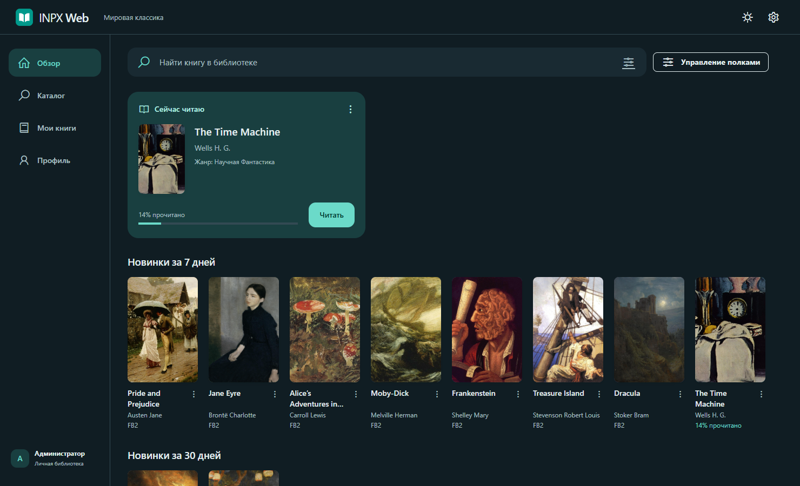

<p align="center">
  <a href="https://t.me/inpxweb">
    
  </a>
</p>

# inpx-web-7z

Веб-каталог и читалка для домашней библиотеки в формате INPX с архивами ZIP и 7z. Есть поиск по каталогу, личные полки, закладки, OPDS, синхронизация с KOReader и отправка книг через Telegram или почту.

[](https://github.com/AceAsket/inpx-reader-releases/releases/latest)
[](#сервер-на-android)

## Выпуски

Чтобы ускорить работу с большими библиотеками, мы перенесли разработку сервера с Node.js на Rust. **Node.js 1.8.3** — последняя ветка классического сервера. Она будет получать только исправления ошибок. Все новые функции будут выходить только в **Rust 2.x**.

| Редакция | Docker-образ | ZIP и установщик Windows |
| --- | --- | --- |
| Rust 2.0.1 · стабильная | `aceasket/inpx-web-7z:2.0.1` или `:latest` | [Скачать Rust 2.0.1](https://github.com/AceAsket/inpx-web/releases/tag/v2.0.1) |
| Rust 2.0.2 RC6 · для проверки | `aceasket/inpx-web-7z:2.0.2-rc.6` | [Скачать Rust RC6](https://github.com/AceAsket/inpx-web/releases/tag/v2.0.2-rc.6) |
| Классический Node.js 1.8.3 · стабильная | `aceasket/inpx-web-7z:1.8.3` | [Скачать Node.js 1.8.3](https://github.com/AceAsket/inpx-web/releases/tag/v1.8.3) |

Ветки `main` и `develop` содержат сервер Rust. При обновлении контейнера с тегом `latest` он перейдёт на Rust. Чтобы продолжить использовать стабильный Node.js, закрепите тег `1.8.3`. Классический сервер с JembaDB поддерживается в ветке [nodejs_depr](https://github.com/AceAsket/inpx-web/tree/nodejs_depr).

Перед переходом с Node.js остановите прежний сервер и сохраните копию каталога данных, включая `db` и внешний файл фильтра, если он используется. При первом запуске Rust сохраняет снимок пользовательских данных и строит новый индекс с сохранением идентификаторов книг, полок, закладок и прогресса. [Переход и откат](./docs/upgrade-rollback.md)

## Запуск Rust в Docker

Замените путь к папке библиотеки и имя файла `.inpx` на свои.

```sh
docker run -d --name inpx-web --restart unless-stopped \
  -p 12380:12380 \
  -e INPX=/library/my-library.inpx \
  -e LIBDIR=/library \
  -v inpx-web-data:/usr/local/bin/.inpx-web \
  -v /path/to/library:/library:ro \
  aceasket/inpx-web-7z:2.0.1
```

Откройте `http://localhost:12380` на сервере или укажите его адрес вместо `localhost`. Профили и настройки сохраняются в томе `inpx-web-data`. [Пример Docker Compose](./docker-compose.full.yml) · [Docker Hub](https://hub.docker.com/r/aceasket/inpx-web-7z)

## Интерфейс

На обзоре видны текущая книга, прогресс чтения и полки с новинками.

[](./docs/images/rust-2-overview.png)

| Каталог с фильтрами и карточками книг | Читалка в режиме разворота, тема «Сепия» |
| --- | --- |
| [](./docs/images/rust-2-catalog.png) | [](./docs/images/rust-2-reader.png) |

Скриншоты сделаны в Rust 2.0.0 на демонстрационной библиотеке. Тексты и иллюстрации взяты из [Standard Ebooks](https://standardebooks.org/ebooks).

## Android

### Читалка INPX Reader для Android

Подключается к библиотеке по адресу сервера или QR-коду. Книги и готовую озвучку можно скачать для чтения и прослушивания без сети. [Скачать INPX Reader](https://github.com/AceAsket/inpx-reader-releases/releases/latest)

### Сервер на Android

INPX Server запускает библиотеку с локальной папки или по SMB на телефоне, планшете или ТВ-приставке с Android 9+. Выбирайте APK по разрядности Android. [Предрелиз и контрольные суммы](https://github.com/AceAsket/inpx-web/releases/tag/android-v0.7.3) · [Инструкция](https://github.com/AceAsket/inpx-web/blob/android/android/README.md)

## Документация

- [Справочник по установке и настройке](./REFERENCE.md) · [Сборка Rust из исходников](./REFERENCE.md#сборка-с-автономным-rust-сервером)
- [Обновление и откат](./docs/upgrade-rollback.md) · [Профили ресурсов](./docs/resource-profiles.md)
- [OPDS 2.0](./docs/opds-v2.md) · [Синхронизация с KOReader](./docs/koreader-sync.md) · [Озвучка Silero](./docs/silero-tts.md)
- [Справочник классического Node.js 1.8.3](https://github.com/AceAsket/inpx-web/blob/v1.8.3/README.md) · [Справочник 1.8.1](./docs/reference-1.8.1.md)

## Обратная связь

[Telegram-сообщество @inpxweb](https://t.me/inpxweb) · [Сообщить об ошибке или предложить улучшение](https://github.com/AceAsket/inpx-web/issues) · [История выпусков](https://github.com/AceAsket/inpx-web/releases)
