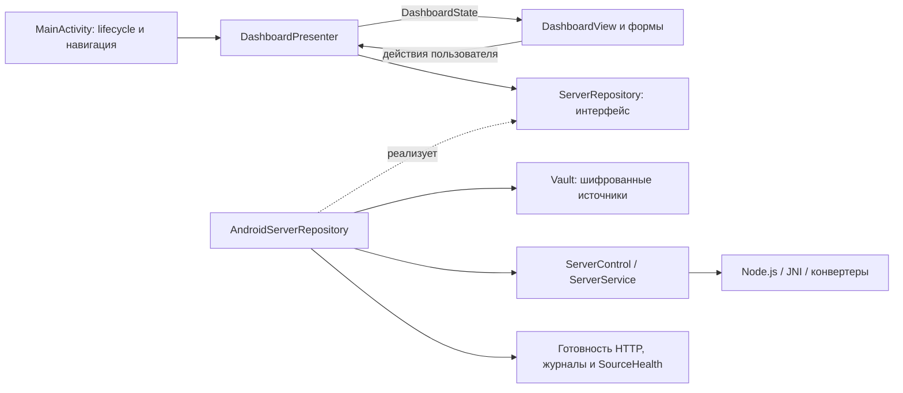

# Архитектура Android-приложения

Нативная панель использует MVP с Repository и неизменяемым состоянием экрана. Код `presentation/` не зависит от Android, JSON, файловой системы и сети; его можно проверять обычными JVM-тестами.



## Ответственность классов

| Часть | Ответственность |
| --- | --- |
| `MainActivity` | Создание зависимостей, Android lifecycle, разрешения, системный выбор папки, маршрутизация действий. |
| `presentation/DashboardPresenter` | Команды, обновление состояния, фоновые исполнители, периодическая проверка, обработка ошибок и устаревших результатов. |
| `presentation/DashboardState` | Снимок экрана и явные фазы `LOADING`, `STOPPED`, `STARTING`, `RUNNING`, `STOPPING`, `ERROR`. Коллекции защищены от изменения. |
| `presentation/ServerRepository` | Контракт чтения состояния и записи настроек, управления сервером и источниками. |
| `AndroidServerRepository` | Android-реализация контракта: Vault, настройки, сервис, HTTP `/ready`, журналы, доступность источников и сеть. Хранит только application context. |
| `DashboardView` | Сенсорная и ТВ-компоновки. Получает готовые данные, обновляет текст и сохраняет фокус при опросе. |
| `SourceDialogs` | Добавление, редактирование, удаление источников и диагностика. |
| `SettingsDialogs` | Формы режима интерфейса, порта и фоновой работы. |
| `ConnectionDialogs` | Адрес, QR-код, каталог, журнал и сообщество. |
| `DialogUi` | Общие размеры, цвета, поля ввода, клавиатура и переходы фокуса. |
| `HandlerScheduler` | Адаптер главного потока для Presenter. |
| `FocusRequests` | Однократный запрос фокуса после подключения View, активации окна и завершения layout. Запрос к уже заменённому экрану отбрасывается. |

Файлы Android-адаптеров и экранов пока находятся в общем пакете `ru.inpx.server`, рядом с существующим JNI и сервисом. Чистая логика выделена в пакет `presentation`; её зависимости направлены только к интерфейсу Repository.

## Правила расширения

1. Новое состояние или данные экрана добавляются в неизменяемую модель, а не в поля Activity или статические переменные.
2. Новое действие проходит через Presenter. Android API, файлы, HTTP и сохранение настроек реализуются в Repository. Долгая проверка источников выполняется отдельным исполнителем, чтобы не задерживать опрос сервера.
3. Формы возвращают `SourceDraft` или значения настроек через команды Presenter. `SourceInfo` для главного экрана не содержит пароля, логина и URI разрешения SAF.
4. Источники изменяются по стабильному ID. Repository перечитывает Vault и сохраняет целый результат после успешной проверки; UI не меняет массив источников до сохранения.
5. Простые изменения статуса обновляют существующие View. Перестройка нужна только при изменении структуры источников или режима управления: `DashboardState.layoutKey()` исключает здоровье источников и фазу сервера.
6. `resume/pause/close` управляют опросом. Результат чтения, начатого до новой команды или смены lifecycle, не перезаписывает новое состояние. Закрытый Presenter освобождает View и не вызывает экран.
7. Признак готовности каталога берётся из `/ready`. Наличие процесса не означает готовность поиска. Остановка отображается отдельной фазой.

Форматы Vault, настроек и протокола управления службой сохранены. `sourceVersion` в файле управления — SHA256 снимка источников при запуске; помогает показать неприменённые изменения, не записывая туда учётные данные. Старый файл без этого поля читается как раньше.

## Проверки при изменениях

```powershell
wsl -d Ubuntu -- bash scripts/android/build-apk.sh testDebugUnitTest assembleDebugAndroidTest lintDebug
adb install -r dist/android/inpx-server-0.6.0-arm64-debug.apk
adb install -r android/app/build/outputs/apk/androidTest/debug/app-debug-androidTest.apk
adb shell am instrument -w -e background true ru.inpx.server.test/ru.inpx.server.UiSmokeInstrumentation
```

`DashboardPresenterTest` использует управляемые очереди без сети и ожиданий: проверяет гонку старого опроса с командой запуска, повторные нажатия, паузу/возобновление, закрытие экрана, ошибки запуска/остановки, отдельную очередь проверки источников, валидацию порта и неизменяемость состояния. `RepositoryChecks` проверяет настоящий шифрованный Repository через изолированные preferences и каталог в кэше: источники по ID, сохранность SMB-пароля, валидацию, настройки и повторный запуск после старой ошибки. Пользовательский Vault не меняется. Device-тесты проверяют сенсорный режим, реальные события пульта, формы, рамки фокуса, фоновую службу и конвертеры. После instrumentation нужно снова открыть приложение и запустить сохранённую библиотеку.
